# Phase 1 — Package Management & Nginx Installation

**Step 1: System update and package management basics**

***Commands:***

sudo su -

\# Check current packages installed

rpm -qa \| wc -l           \# CentOS/Amazon Linux

\# dpkg --list \| wc -l    \# Ubuntu

\# Update all packages

yum update -y             \# CentOS/Amazon Linux

\# apt update && apt upgrade -y   \# Ubuntu

\# Search for a package

yum search nginx

yum info nginx

\# Install useful tools

yum install -y wget curl tree net-tools bind-utils

\# Verify installation

which wget

which curl

which tree

\# Check package info

rpm -qi curl

rpm -ql curl \| head -10

\# List recently installed packages

rpm -qa --last \| head -10

**Output:**

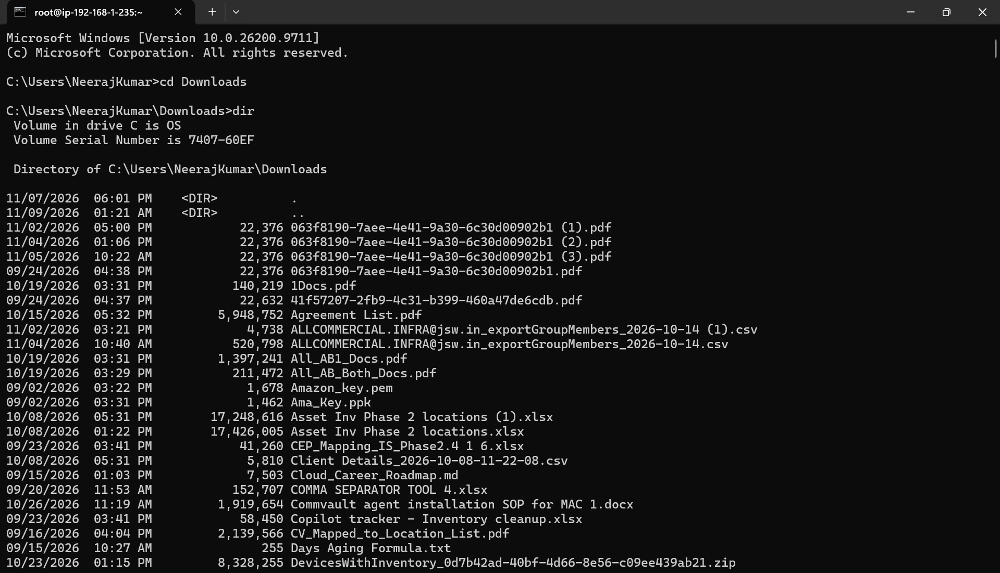

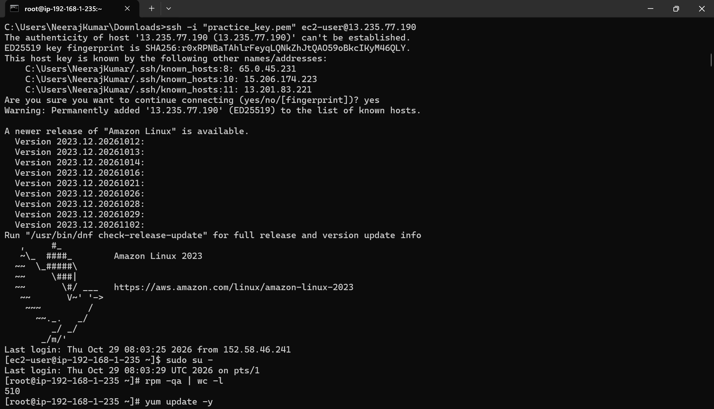

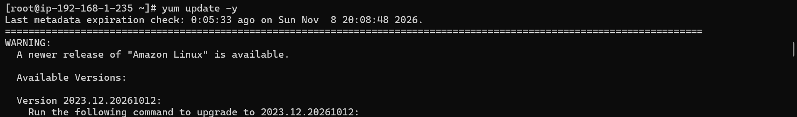

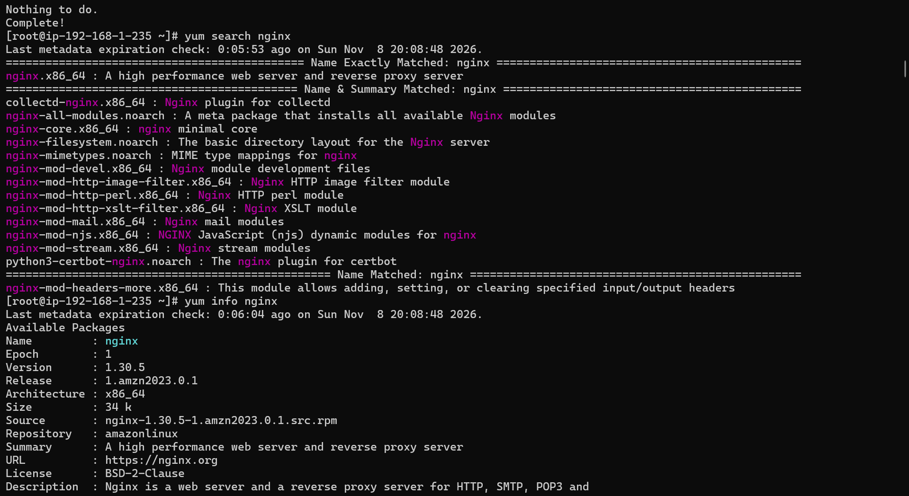

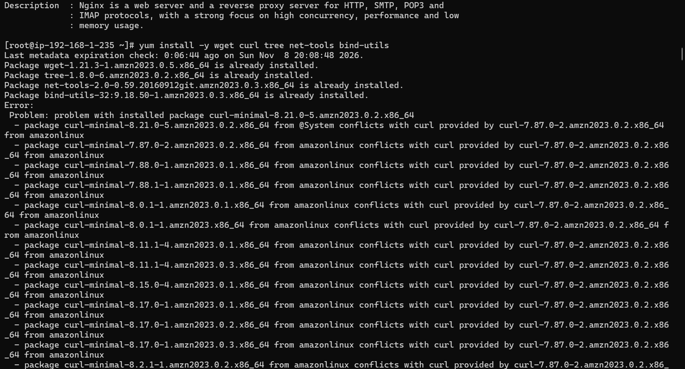

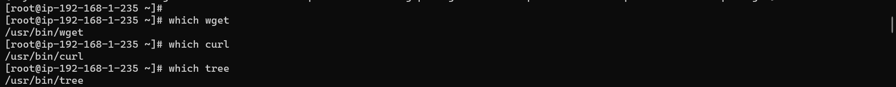

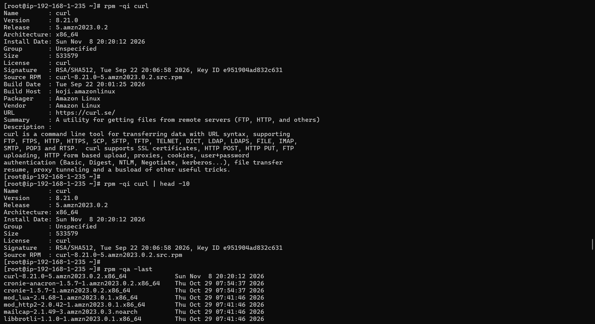

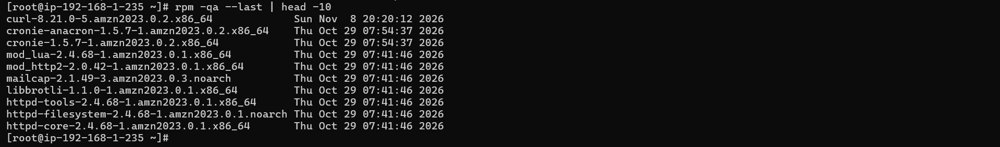

**Step 2: Install and configure Nginx**

***Comands:***

\# Install Nginx

yum install -y nginx       \# Amazon Linux/CentOS

\# apt install -y nginx     \# Ubuntu

\# Verify installation

nginx -v

which nginx

rpm -ql nginx \| head -20

\# Start and enable Nginx

systemctl start nginx

systemctl enable nginx

systemctl status nginx

\# Check Nginx is listening on port 80

ss -tlnp \| grep :80

netstat -tlnp \| grep nginx

\# Test locally

curl http://localhost

curl -I http://localhost   \# headers only  
  
**Output:**

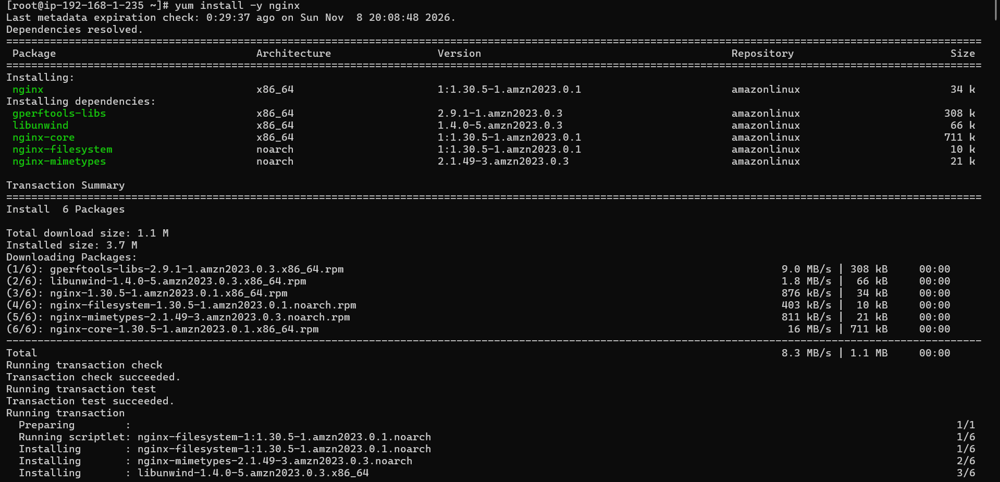

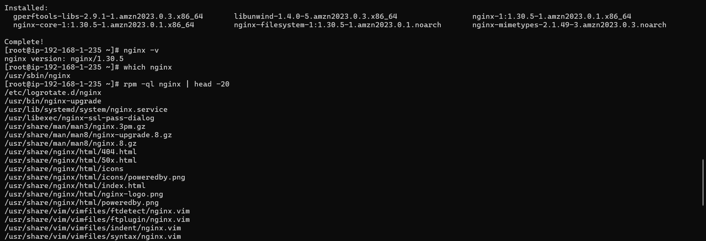

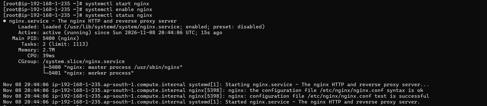

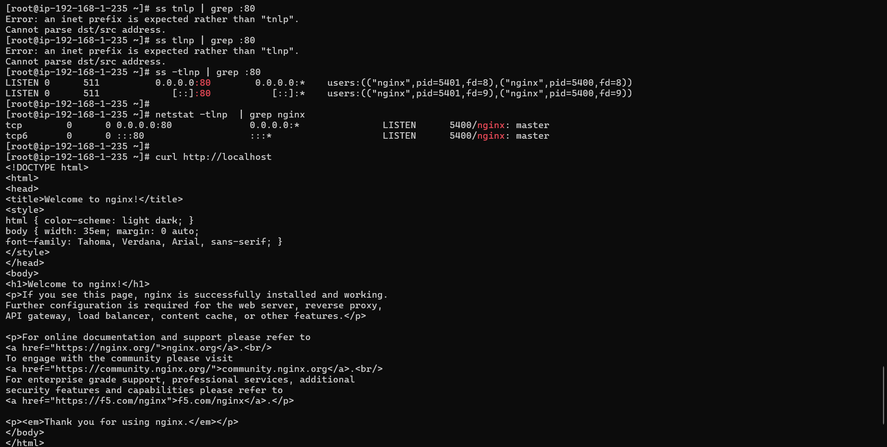

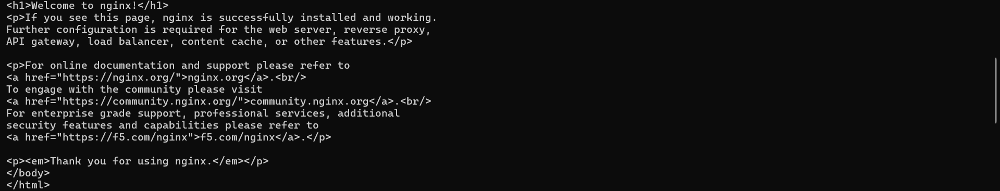

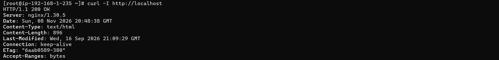

**Step 3: Create a custom website  
*Commands:***

\# Backup default page

cp /usr/share/nginx/html/index.html /usr/share/nginx/html/index.html.bak

\# Create custom page

cat \> /usr/share/nginx/html/index.html \<\< 'EOF'

\<!DOCTYPE html\>

\<html\>

\<head\>

  \<title\>Linux Web Server — Capstone Project 2\</title\>

  \<style\>

    body { font-family: Arial; background: \#1a1a2e; color: \#eee; text-align: center; padding: 50px; }

    h1 { color: \#16213e; background: \#e94560; padding: 20px; border-radius: 8px; }

    .info { background: \#16213e; padding: 20px; border-radius: 8px; margin: 20px auto; max-width: 600px; }

    .green { color: \#00ff88; }

  \</style\>

\</head\>

\<body\>

  \<h1\>Linux Web Server\</h1\>

  \

    \<p\>\Status:\</span\> Online and Running\</p\>

    \<p\>\Project:\</span\> Linux Capstone Project 2\</p\>

    \<p\>\Student:\</span\> \[YourName\]\</p\>

    \<p\>\Server:\</span\> Nginx on Amazon Linux 2023\</p\>

    \<p\>\Purpose:\</span\> Junior Linux Engineer Capstone\</p\>

  \</div\>

\</body\>

\</html\>

EOF

\# Create a second page

cat \> /usr/share/nginx/html/about.html \<\< 'EOF'

\<!DOCTYPE html\>

\<html\>

\<body style="font-family:Arial; text-align:center; padding:50px;"\>

  \<h1\>About This Server\</h1\>

  \<p\>This web server was configured as part of the Linux Capstone Project.\</p\>

  \<p\>Technologies used: Nginx \| Linux \| Firewall \| Shell Scripting\</p\>

  \<a href="/"\>Back to Home\</a\>

\</body\>

\</html\>

EOF

\# Reload Nginx to apply changes

systemctl reload nginx

\# Test in browser or with curl

curl http://localhost

If using EC2, visit http://\<public-ip\> in your browser — your custom page should load.

***Output:***

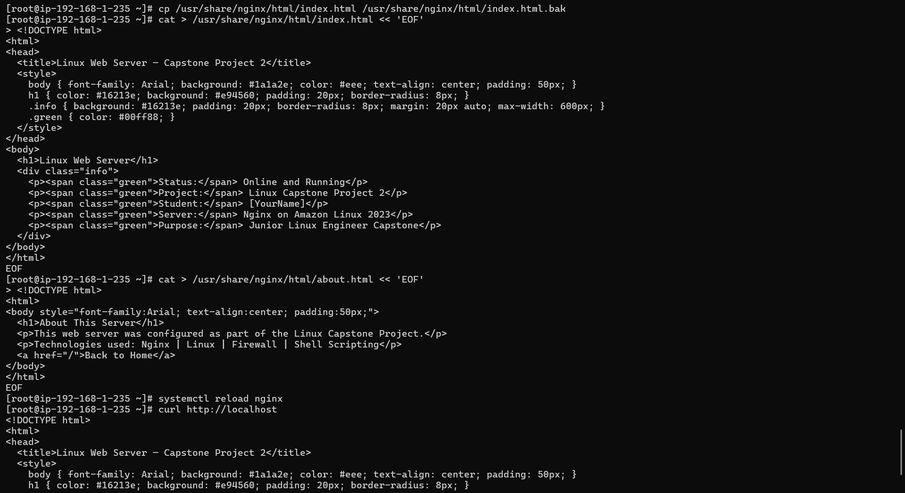

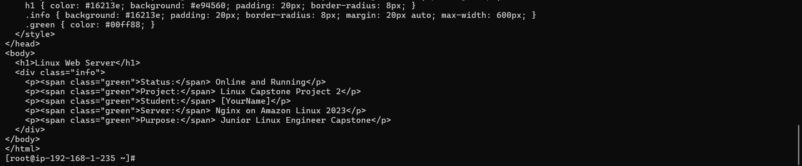

**Step 4: Explore Nginx configuration**

***Commands***

\# View main Nginx config

cat /etc/nginx/nginx.conf

\# View configuration directory

ls -la /etc/nginx/

\# Check Nginx config syntax

nginx -t

\# View default server block

cat /etc/nginx/conf.d/default.conf 2\>/dev/null \|\| cat /etc/nginx/sites-enabled/default 2\>/dev/null

\# View Nginx logs location

grep "access_log\\error_log" /etc/nginx/nginx.conf

**Output:**

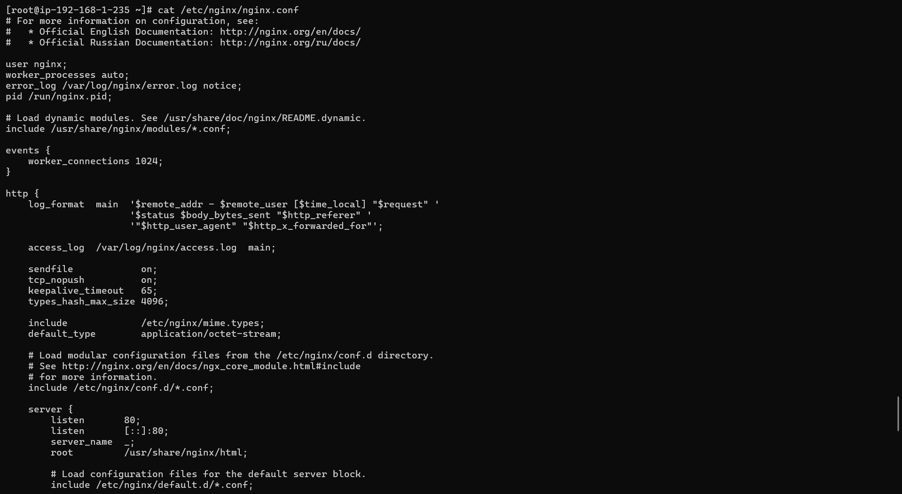

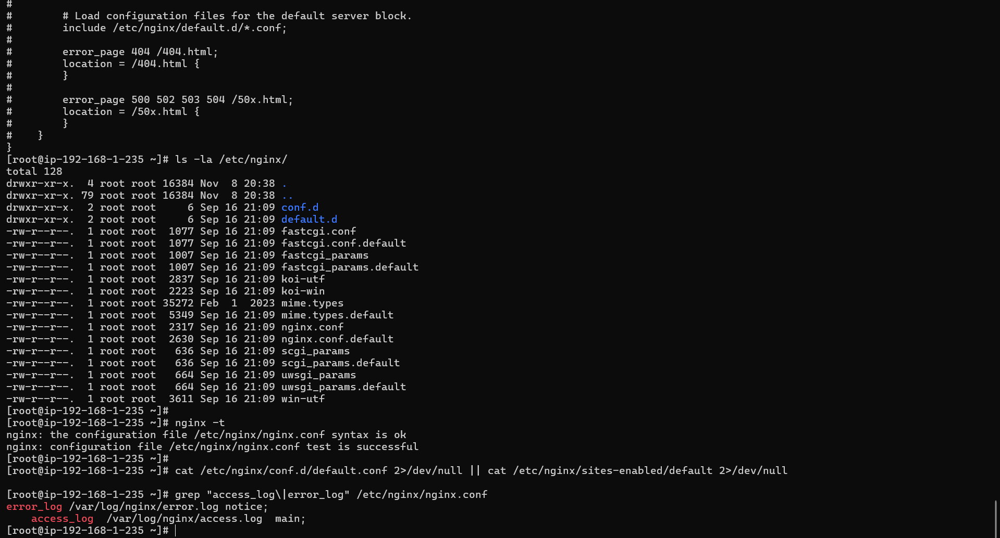
