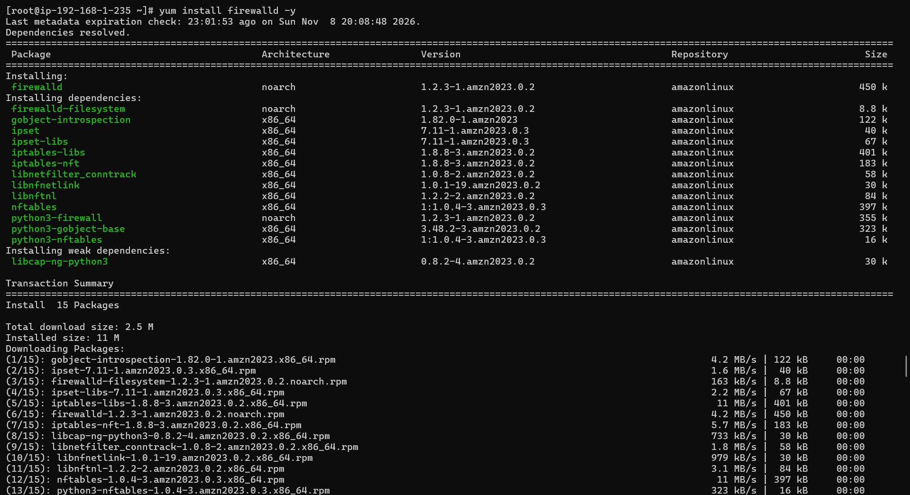
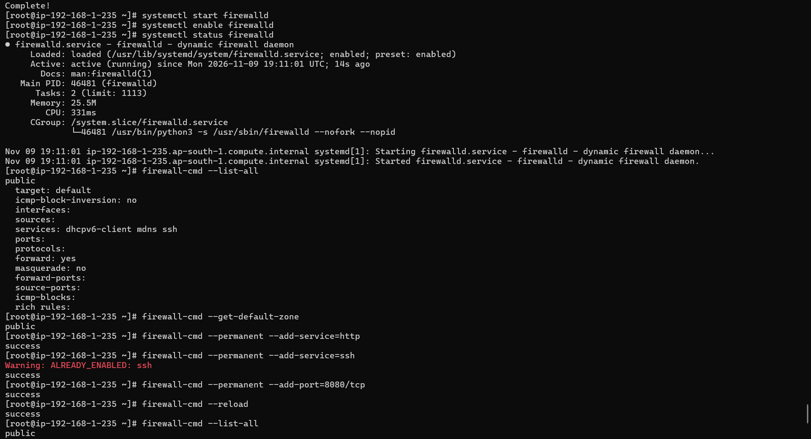
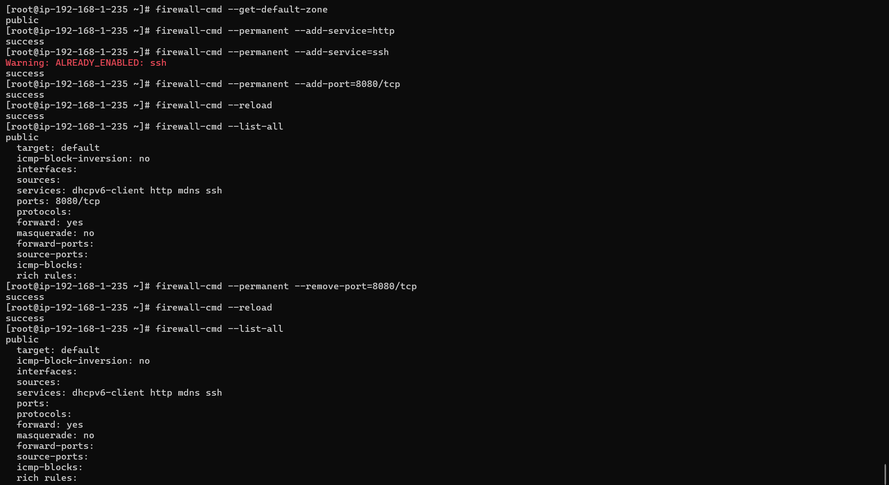
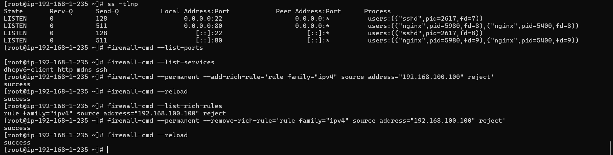

# Phase 2 — Firewall Configuration

**Step 5: Configure firewall with firewalld**

**Commands:**

\# Install firewalld if not present

yum install -y firewalld

\# Start and enable firewalld

systemctl start firewalld

systemctl enable firewalld

systemctl status firewalld

\# Check current firewall rules

firewall-cmd --list-all

\# Check default zone

firewall-cmd --get-default-zone

\# Allow HTTP (port 80)

firewall-cmd --permanent --add-service=http

firewall-cmd --permanent --add-service=ssh

\# Allow a custom port (8080 for testing)

firewall-cmd --permanent --add-port=8080/tcp

\# Reload firewall to apply permanent rules

firewall-cmd --reload

\# Verify rules applied

firewall-cmd --list-all

\# Remove the test port

firewall-cmd --permanent --remove-port=8080/tcp

firewall-cmd --reload

firewall-cmd --list-all

**Output**:

**Step 6: Test firewall blocking**

***Commnads:***

\# Try to access a blocked port from the server itself

curl http://localhost:8080    \# should fail/timeout after removal

\# Check what ports are open

ss -tlnp

firewall-cmd --list-ports

firewall-cmd --list-services

\# Block a specific IP (example — use a test IP)

firewall-cmd --permanent --add-rich-rule='rule family="ipv4" source address="192.168.100.100" reject'

firewall-cmd --reload

firewall-cmd --list-rich-rules

\# Remove the IP block

firewall-cmd --permanent --remove-rich-rule='rule family="ipv4" source address="192.168.100.100" reject'

firewall-cmd –reload

***Output:***

