# Phase 3 — Log Monitoring & Network Commands

**Step 7: Generate and monitor Nginx logs**

***Commands:***

\# Generate web traffic to create log entries

curl http://localhost/

curl http://localhost/about.html

curl http://localhost/nonexistent.html    \# generates 404

curl http://localhost/

curl -A "TestBrowser/1.0" http://localhost/

\# View access logs

tail -20 /var/log/nginx/access.log

\# View error logs

tail -20 /var/log/nginx/error.log

\# Real-time log monitoring (run then make requests in another terminal)

tail -f /var/log/nginx/access.log &

\# Generate more traffic

for i in {1..5}; do curl -s http://localhost/ \> /dev/null; done

\# Stop the tail

kill %1

\# Analyze logs with grep and awk

grep "404" /var/log/nginx/access.log

grep "200" /var/log/nginx/access.log \| wc -l

awk '{print \$1}' /var/log/nginx/access.log \| sort \| uniq -c \| sort -rn

awk '{print \$9}' /var/log/nginx/access.log \| sort \| uniq -c

***Output:***

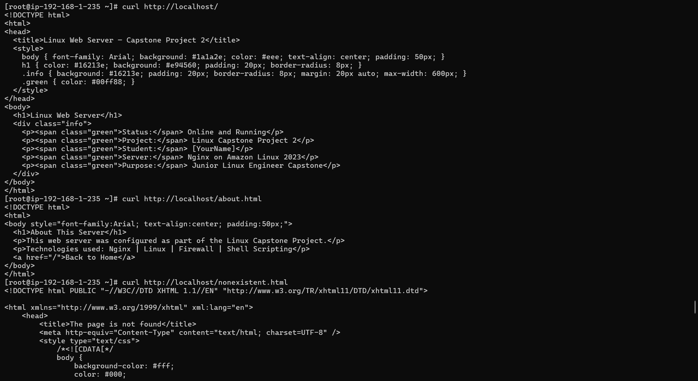

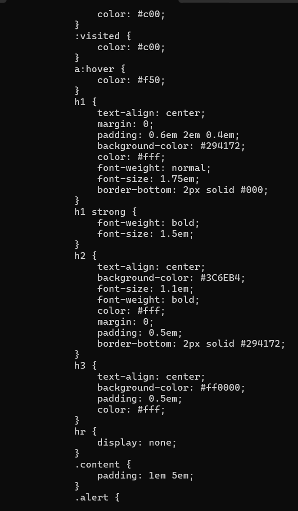 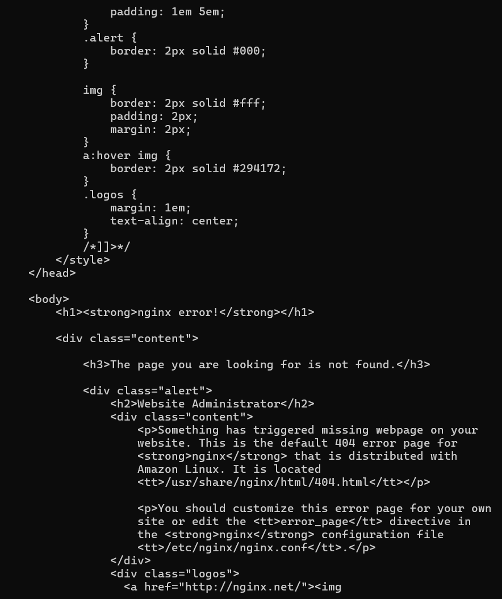

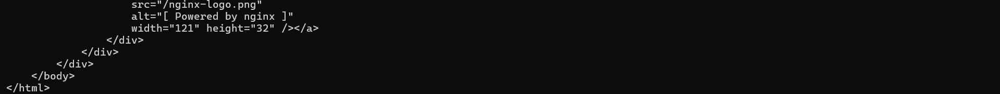

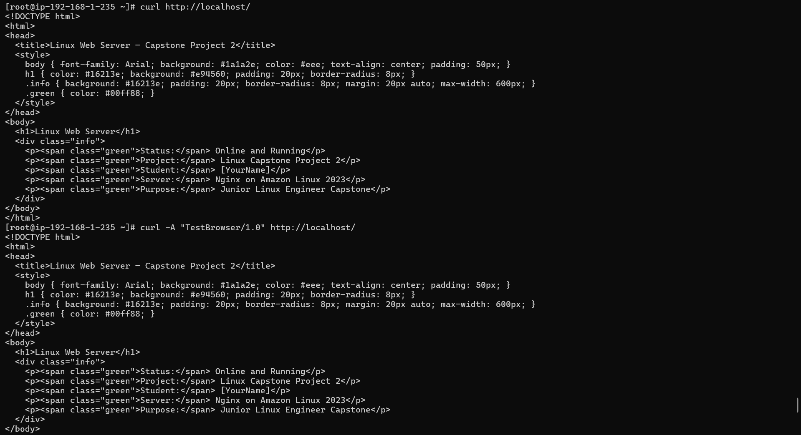

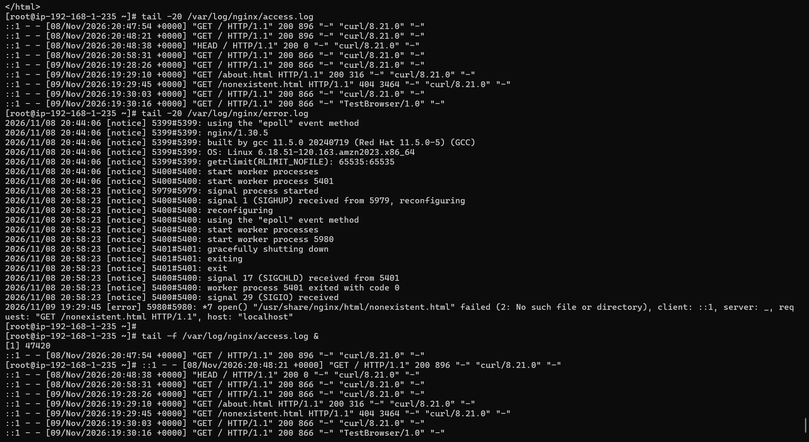

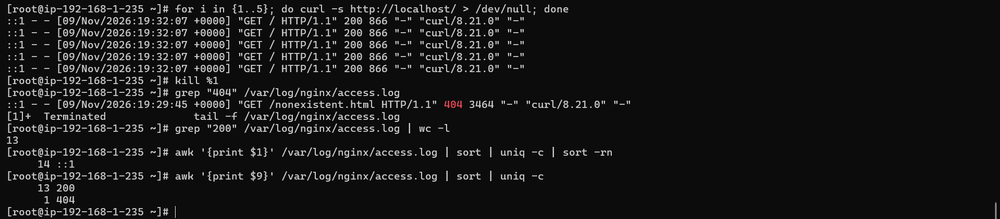

**Step 8: System log monitoring**

***Commands:***

\# View system logs

tail -50 /var/log/messages        \# CentOS/Amazon Linux

\# tail -50 /var/log/syslog       \# Ubuntu

\# View authentication logs

tail -20 /var/log/secure          \# CentOS/Amazon Linux

\# tail -20 /var/log/auth.log     \# Ubuntu

\# Filter for specific events

grep "nginx" /var/log/messages

grep "Failed" /var/log/secure 2\>/dev/null \|\| grep "Failed" /var/log/auth.log 2\>/dev/null

\# Monitor logs live

journalctl -u nginx -f &

sleep 3

curl http://localhost

kill %1

\# View journal for specific service

journalctl -u nginx --since "1 hour ago"

journalctl -u firewalld --since "today"

***Output:  
***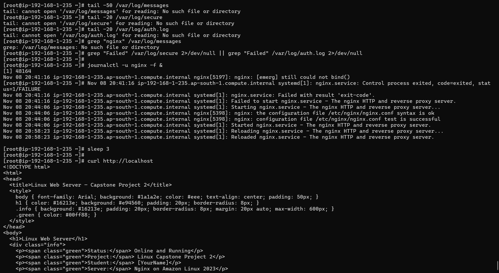

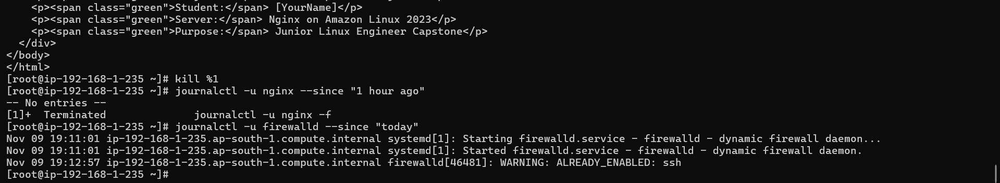

**Step 9: Network commands**

***Commands:***

\# Check network interfaces

ip addr show

ip link show

ifconfig 2\>/dev/null \|\| ip addr

\# Check routing table

ip route show

route -n 2\>/dev/null \|\| ip route

\# Test connectivity

ping -c 4 google.com

ping -c 4 8.8.8.8

\# DNS lookup

nslookup google.com

dig google.com

dig google.com +short

\# Download a file with wget and curl

wget -O /tmp/test_download.html http://localhost/

curl -o /tmp/curl_download.html http://localhost/

ls -lh /tmp/test_download.html /tmp/curl_download.html

\# Check open ports

ss -tlnp

ss -tlnp \| grep nginx

ss -tlnp \| grep :80

\# Check network stats

netstat -s 2\>/dev/null \|\| ss -s

\# Trace route

traceroute google.com 2\>/dev/null \|\| tracepath google.com

***Output:***

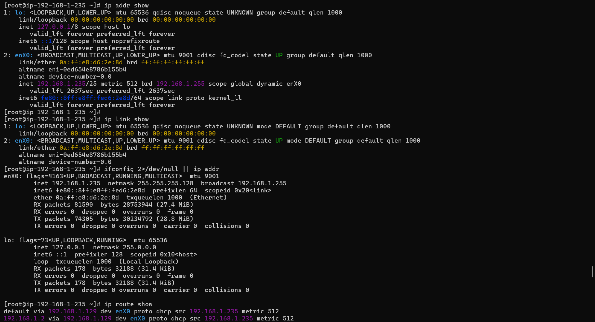

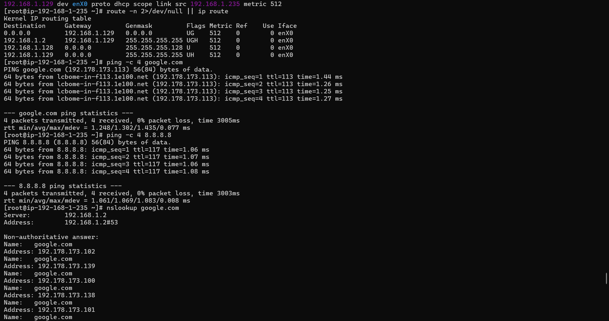

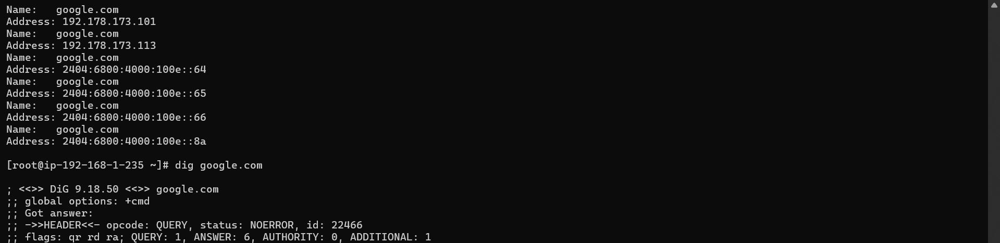

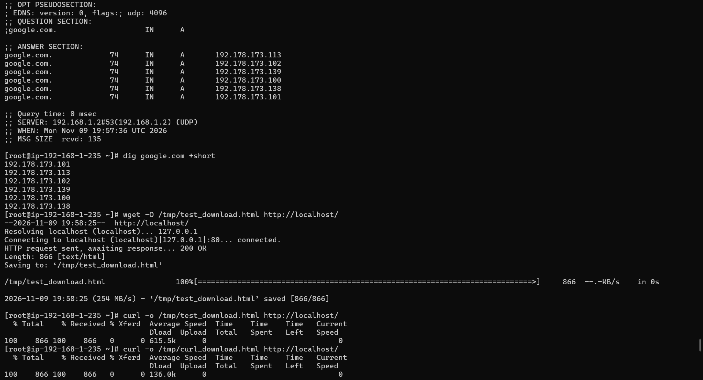

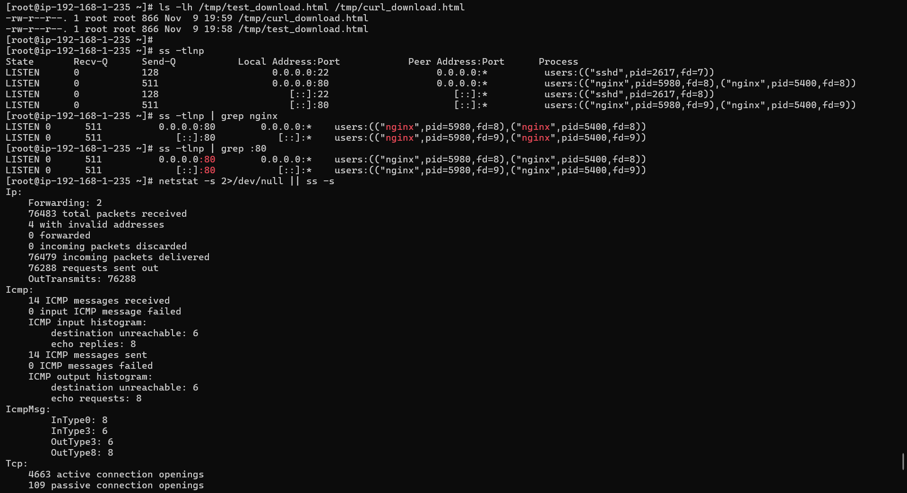

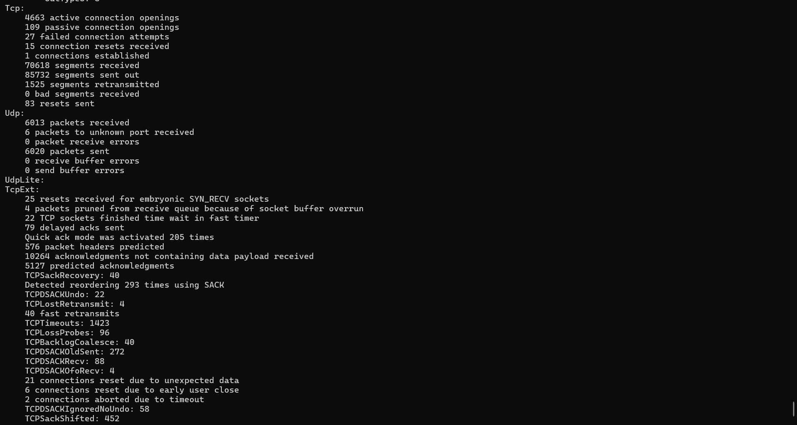

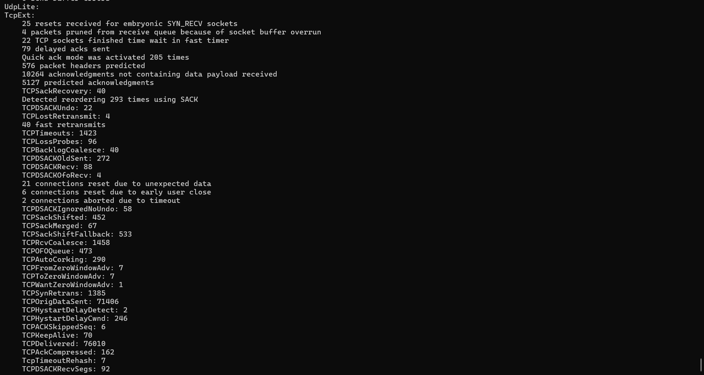

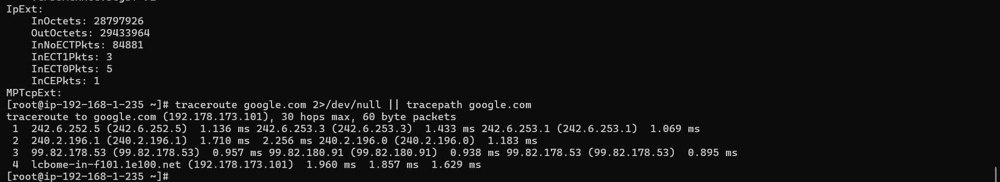
