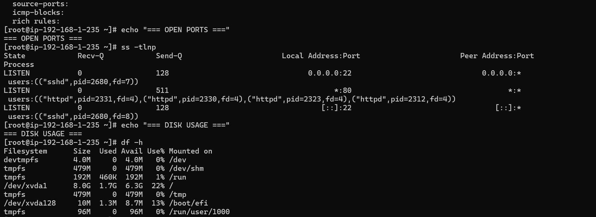
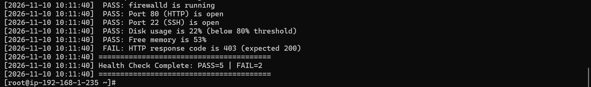
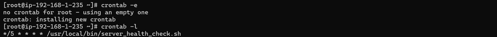

# Linux Web Server Deployment & Automated System Monitoring

A production-style Linux web server built from scratch on **AWS EC2 (Amazon Linux 2023)**.
The project covers package management, Nginx deployment, firewall configuration,
log monitoring, and an automated health-check script scheduled with cron.

## Architecture

```
Linux Web Server (EC2 or VM)
├── Nginx Web Server
 │   ├── Default site (port 80)
 │    └── Custom HTML page
├── Firewall (firewalld)
 │   ├── Allow HTTP (80)
 │   ├── Allow SSH (22)
 │    └── Block everything else
├── Log Monitoring
 │   ├── /var/log/nginx/access.log
 │    └── /var/log/nginx/error.log
 └── Shell Script
     └── server_health_check.sh (auto-runs every 5 min via cron)

```

## Tech Stack
Amazon Linux 2023 · Nginx · firewalld · Bash · cron · systemd · rsyslog · curl · wget · AWS EC2

## What I Built
- Installed and enabled **Nginx** with YUM and verified it with `ss`, `curl` and `systemctl`
- Deployed a custom two-page website and reloaded Nginx without downtime
- Configured **firewalld**: allowed HTTP/SSH, opened and closed a test port, blocked and unblocked an IP with a rich rule
- Analysed Nginx logs with `grep`, `awk`, `sort`, `uniq` and `tail -f` (200 vs 404 counts, requests per IP)
- Explored system logs and `journalctl` for service-level troubleshooting
- Ran network diagnostics: `ip`, `ping`, `dig`, `nslookup`, `traceroute`, `wget`, `curl`
- Wrote **`server_health_check.sh`**: checks services, ports, disk, memory and HTTP status, and auto-restarts failed services
- Scheduled it every 5 minutes with **cron**
- Wrote **`manage_nginx.sh`** (start/stop/restart/status) using a `case` statement

## Repository Structure

| Path | Contents |
|------|----------|
| `scripts/` | `server_health_check.sh`, `manage_nginx.sh` |
| `web/` | `index.html`, `about.html` |
| `docs/` | Step-by-step commands and screenshots for each phase |
| `screenshots/` | Terminal output proof for every step |
| `sample-logs/` | Sample output from the health check |

## Step-by-Step Documentation
1. [Package Management & Nginx Installation](docs/01-package-management-and-nginx.md)
2. [Firewall Configuration](docs/02-firewall-configuration.md)
3. [Log Monitoring & Network Commands](docs/03-log-monitoring-and-networking.md)
4. [Shell Scripting & Automation](docs/04-automation-and-cron.md)

## Screenshots

**Nginx running**


**Firewall rules**


**Health check output**


**Cron job**


## How to Run
```bash
# 1. Launch EC2 t2.micro (Amazon Linux 2023); allow ports 22 and 80 in the Security Group
# 2. Install Nginx and firewalld
sudo yum install -y nginx firewalld
sudo systemctl enable --now nginx firewalld

# 3. Deploy the site
git clone https://github.com/<your-username>/linux-nginx-web-server-capstone.git
cd linux-nginx-web-server-capstone
sudo cp web/*.html /usr/share/nginx/html/
sudo firewall-cmd --permanent --add-service=http --add-service=ssh && sudo firewall-cmd --reload

# 4. Install the scripts
sudo cp scripts/*.sh /usr/local/bin/ && sudo chmod +x /usr/local/bin/*.sh

# 5. Run the health check and schedule it
sudo /usr/local/bin/server_health_check.sh
(sudo crontab -l 2>/dev/null; echo "*/5 * * * * /usr/local/bin/server_health_check.sh") | sudo crontab -
```

## Sample Health Check Output
```
[2026-11-10 10:11:40] ========================================
[2026-11-10 10:11:40] Server Health Check Started
 PASS: nginx is running
 PASS: firewalld is running
 PASS: Port 80 (HTTP) is open
 PASS: Port 22 (SSH) is open
 PASS: Disk usage is 22% (below 80% threshold)
```
> Replace this block with 10-15 real lines from your own `/var/log/health_check.log`.

## Key Learnings
- `reload` re-reads Nginx config without dropping connections; `restart` stops and starts the service
- firewalld rules need `--permanent` to survive reboot, and `--reload` to apply them
- Logs (`/var/log/nginx`, `journalctl`) are the first place to look when troubleshooting
- Cron + shell scripting turns manual checks into automated monitoring
- Bug found and fixed: the original script set the timestamp once, so every log line showed the same time. It is now generated per log entry.

## Author
**Neeraj Kumar** · [LinkedIn](https://github.com/Neeraj13579/) · neeraj453318@gmail.com
